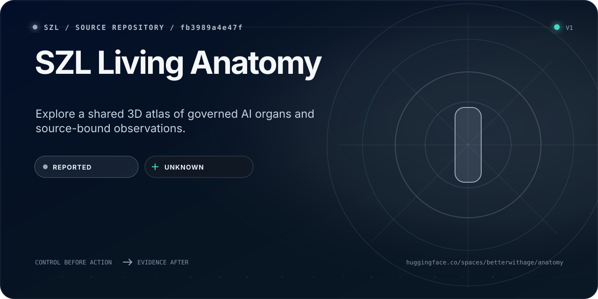

<!-- szl:header v1 -->
<!-- Native identity: szl-brand@4309f6fce89179331b0b3ed8c99494e76c5be256; Orbit v2 icon. -->
<p>
  <a href="https://github.com/szl-holdings">
    
  </a>
</p>

**Control before action. Evidence after.**

[Product](https://a-11-oy.com) · [Proof](https://a11oy.net) · [GitHub organization](https://github.com/szl-holdings)
<!-- /szl:header -->

<!-- Native identity: szl-brand@4309f6fce89179331b0b3ed8c99494e76c5be256; Orbit v2 icon sha256 6e2b7d72a3af3d9602b79de41df0194ede6496a9661f057108ec224c0efc92e6. -->
<!-- Surface Foundry: szl-brand@b519affbd63447c086cb74b6e0636661bcac09a6; input README.surface.json; receipt README.surface-receipt.json. Generation metadata is not live runtime evidence. -->
<p><a href="https://github.com/szl-holdings"></a></p>

<!-- SZL-SURFACE-CARD:v3:START -->
<p align="center">
  <a href="https://huggingface.co/spaces/SZLHOLDINGS/anatomy">
    
  </a>
</p>

> Explore a shared 3D atlas of governed AI organs and source-bound observations.

| Path | What a non-technical reader gets | Where a builder starts |
| --- | --- | --- |
| **Understand** | See how the organ map connects source, observations and limits. | [Open the primary surface](https://huggingface.co/spaces/SZLHOLDINGS/anatomy) |
| **Build** | Inspect the atlas, shared integrity-kernel links and local runtime. | [Inspect source](https://github.com/szl-holdings/anatomy) |
| **Verify** | `REPORTED` evidence · `UNKNOWN` runtime | [Inspect evidence](https://github.com/szl-holdings/anatomy/blob/a03896dc4beea37656ec45c400b4c23912dd6714/README.md) |

<sub>Source presentation; current runtime was not checked for this card. The atlas grants no action authority. Energy remains UNAVAILABLE and Λ remains Conjecture 1. A signature proves scoped integrity and origin; it does not prove accuracy, safety, performance, compliance, or authorization.</sub>
<!-- SZL-SURFACE-CARD:v3:END -->


<details>
<summary>Visual source and reproduction</summary>

This card is generated by [SZL Surface Foundry](https://github.com/szl-holdings/szl-brand/tree/b519affbd63447c086cb74b6e0636661bcac09a6) from [the reviewed source contract](https://github.com/szl-holdings/anatomy/blob/main/README.surface.json). [The generation receipt](https://github.com/szl-holdings/anatomy/blob/main/README.surface-receipt.json) binds its copy and SVG; it does not attest live publication or independent product verification.

At that exact brand revision, run `PYTHONPATH=src python -m szl_brand.surface /path/to/README.surface.json --output /tmp/szl-readme-card`. Copy the generated SVG to `readme-surface-card.svg` and the receipt to `README.surface-receipt.json`; update only the v3 managed block and preserve the surrounding source bytes.

Native SZL artwork is reused from its [licensed source](https://github.com/szl-holdings/szl-brand/blob/4309f6fce89179331b0b3ed8c99494e76c5be256/NOTICE) with CC BY 4.0 attribution to SZL Holdings and the source trademark reservation.

</details>

# SZL Living Anatomy 🫀

> **Governed AI you can prove — as a living body.**
> A 3D, navigable map of the governed organism: its organs, how a single decision
> flows through them, and where each proof and conjecture honestly sits.

> **The living substrate · 5 systems · Λ heart · DSSE Khipu receipt bus · honest by design**
>
> **Shared, embeddable 3D scene** — rendered inside the a11oy and killinchu consoles; a visualization component, not a separate governance console.

[-c9b787?style=flat-square)](https://github.com/szl-holdings/anatomy/actions/workflows/hf-sync.yml)
[](https://github.com/szl-holdings/.github/tree/main/doctrine)
[](https://github.com/szl-holdings/anatomy)
[](https://github.com/szl-holdings/lutar-lean/blob/main/BOUNTY.md)
[](https://github.com/szl-holdings/khipu-consensus)

The governed-AI organ substrate shared by **a11oy** (governed-AI command body) and
**killinchu** (maritime / drone C2 body): two bodies, one circulatory + nervous mesh,
with the Λ heart at the center.

## Live integrity kernel (szl-khipu)

This repository is the **3D atlas** (SLSA L1 static viz). The fail-closed organ-integrity
kernel that actually runs the five organs lives in
[szl-holdings/szl-khipu](https://github.com/szl-holdings/szl-khipu) as `evaluate_anatomy`,
and on the KHIPU Space **Anatomy** tab:
[SZLHOLDINGS/szl-khipu](https://huggingface.co/spaces/SZLHOLDINGS/szl-khipu).
The command body exposes the same fail-closed contract at
[`GET/POST /api/a11oy/v1/organs/integrity`](https://a-11-oy.com/api/a11oy/v1/organs/integrity),
and this Space serves its own copy of the kernel (`organ_integrity.py`) at
`GET/POST /api/anatomy/v1/organs/integrity`. The former standalone repository,
[szl-holdings/szl-organ-integrity](https://github.com/szl-holdings/szl-organ-integrity),
is archived (read-only history); the Evidence Bay now ships inside this atlas (below).

HEART/YUYAY · YAWAR · YACHAY · OTel · Khipu skeleton. Any DOWN organ or a WILLAY veto
blocks the body. Λ = Conjecture 1 OPEN. Energy UNAVAILABLE. Locked-proven stays 8.
Not a Three.js rehost of this Space — the other way around: this Space is the map,
szl-khipu is the kernel.

## Evidence Bay — the proof boundary

The 3D organism now has a machine-readable evidence boundary without replacing its
visual language. Open **Evidence Bay** from the atlas to inspect every major surface
through the same five-part contract: **Purpose · Try · Evidence · Limits · Reproduce**.

- Transport, evidence, verification, and authority are separate dimensions. A
  `RUNNING` Space is not treated as proof of model quality, freshness, or safety.
- The deployed bundle emits a deterministic SHA-256 integrity receipt. Its local
  verifier recomputes every declared file and deliberately returns
  `STRUCTURAL-ONLY` because the public visualization has no signing key.
- Live A11OY (including its public receipt verifier) and Killinchu dependencies
  are probed separately and timestamped. The Evidence Bay validates bounded, typed JSON responses;
  HTTP 200, HTML fallbacks, rate limits, and an empty `UNKNOWN` organ response
  cannot establish live organ measurements. It separates reachability, contract
  validation, reported posture, and measured fields, with latency and SHA-256
  response fingerprints. A verifier rejecting an empty request is recorded as
  an input-validation observation, never a successfully verified receipt.
- Killinchu observations use its source-declared `/evidence` contract and retain
  its `PARTIAL` evidence state. The retired standalone receipt-verifier Space is
  absent from the Hub and is no longer probed; an unavailable surface is never
  silently replaced or declared healthy.
- Observations are shared across concurrent refresh requests, bounded to 64 KiB
  per response, and cached for 30 seconds. The UI marks observations older than
  60 seconds stale. Upstream declarations remain distinct from independent proof.
- Formula claims link to their source files. This Space presents a declared
  snapshot—it does not run Lean—and Λ remains Conjecture 1.
- `/.well-known/szl-source.json` exposes the declared GitHub base, measured HF
  revision, artifact-set digest, and the remaining GitHub-sync state. Automated
  deployments add `hf-deploy-manifest.json`, binding the served runtime
  whitelist to the exact current protected-main commit rechecked immediately
  before publication; this is a source-bound deployment claim, not a
  whole-repository byte-parity claim.
- Bundle receipts include the organ kernel, container definition, pinned runtime
  requirements and base stylesheet. Publication includes the source favicon,
  checks the typed observation contract, and uses the exact HF parent revision
  after rechecking GitHub main at the upload boundary.

## v7 — YACHAY Neural Quant brain

The atlas now mounts a source-bound **Neural Quant v7** instrument over the
existing 3D organism. It observes the exact 575-chunk public Second Brain, the
review-gated frontier candidate set, 30 attributed formula records, 21 executable
formula kernels, nine quant domains, and bounded Ouroboros loop metadata.

The v7 interface is read-only and handles-only. It shows source revisions and
SHA-256 receipts, never raw candidate content. The private graph is not loaded;
training, promotion, execution, merge, and provider mutation remain `NONE`.
Locked-proven remains exactly eight, the F-number mapping remains
`UNKNOWN_NOT_INFERRED`, and Lambda remains Conjecture 1.

Frontier source revisions are typed: repository sources use exact `git-sha1`
commits; public research metadata uses `metadata-capture-sha256` receipts.
The materializer and both read-only consumers validate the individual canonical
capture, bounded provider provenance, and aggregate provider receipt. Public
handles retain `revisionKind` and the declared metadata identity and licence;
full-text licensing stays `NOT_INFERRED`. The enclosing Second Brain snapshot
remains bound to its exact Git commit.

Open the floating **Neural Quant v7** control or use
`/api/anatomy/v1/brain/neural-quant-v7`. The desktop panel becomes a mobile
bottom sheet with 44-pixel controls, safe-area support, reduced motion, high
contrast, forced colors, keyboard focus trapping, and Escape close.

Public creator-profile Space:
[`SZLHOLDINGS/anatomy`](https://huggingface.co/spaces/SZLHOLDINGS/anatomy).

## Holographic v7 companion instrument

Holographic v7 is a read-only, same-origin companion to Neural Quant v7. It
serves the source-bound Second Brain through the frontier runtime without
creating a second authority plane. The public snapshot remains 575 chunks with
30 attributed formulas, 21 executable formulas, and nine quant domains. Public
identity stays `HANDLES_ONLY`; lambda remains `Conjecture 1`, and every frontier
candidate remains review-gated rather than promoted by the visualization.

## v6 — alive-proof layer (ratchet 2026-07-21)

The **⛬ alive-proof (v6)** control closes the loop between the map and the
running substrate. It fetches the latest anatomy alive-harness run from the
restored public sink ([`SZLHOLDINGS/test-results`](https://huggingface.co/datasets/SZLHOLDINGS/test-results)),
verifies the run's DSSE (PAE v1) ECDSA-P256 signature **in the browser**
against the pinned, committed org key
([`hatun-mcp/PUBKEY_szlholdings-ec-p256.pem`](https://github.com/szl-holdings/hatun-mcp/blob/main/PUBKEY_szlholdings-ec-p256.pem)),
and only then displays the run — verdict, live assertion counts, per-layer
results, and the formula-gate pass rate, all **derived from the signed
evidence**, never hand-typed. Runs were signed by the Hatun MCP gateway
(`dsse_sign`, keyid `szlholdings-ec-p256`; its standalone Space is now retired,
so the panel implies no live gateway) and published by a fail-closed
publisher that verifies before and after upload. If the sink is unreachable or
a signature fails, the panel says so — no fabricated green light. A signed
GREEN run proves liveness at the time it ran, not doctrine upgrades:
locked-proven stays exactly 8 and Λ remains Conjecture 1.

**Current state (checked 2026-11-06):** the page's own Content-Security-Policy
`connect-src` (the `server.py` header and the `index.html` meta policy) lists
neither `huggingface.co` nor `raw.githubusercontent.com`, so the browser refuses
both fetches and the panel reports `UNREACHABLE`. That is the fail-closed path,
never a fabricated result. The newest signed runs in the sink finished on
2026-07-21.

Machine-readable routes:

| Route | Meaning |
|---|---|
| `/version` | Exact GitHub source and deployed HF revision (`MEASURED` only when source-bound) |
| `/evidence` | Release identity, structural bundle receipt, and dependency evidence index |
| `/api/anatomy/v1/manifest` | Contract, state vocabulary, doctrine boundary |
| `/api/anatomy/v1/capabilities` | Five-part capability shell and provenance |
| `/api/anatomy/v1/evidence?refresh=1` | Fresh dependency contract probes |
| `/api/anatomy/v1/receipt` | Deterministic local artifact receipt |
| `POST /api/anatomy/v1/verify/receipt` | Replay local integrity; structural only |
| `/.well-known/szl-source.json` | GitHub ↔ HF deployment-source attestation |

## What's new in v5 — conscience, sovereign mesh, verifiable receipts (evolves v4)

v5 **evolves** v4 (it does not replace it): the entire v4 engine (`data.js` / `app.js`,
dissection dock, live-body, yarqa CFD) is preserved. A single additive module
(`v5_organs.js`, same vendored-free / 0-CDN / no-build posture) layers on six new,
honestly-labeled capabilities — all read-only against the live a11oy origin:

- **WILLAY — conscience / immune-gate organ (NEW).** Five **inspectable** signed-refusal
  classifiers (cyber · bio dual-use · hidden-reasoning extraction · prompt-injection /
  governance bypass · self-harm), trust ceiling 0.97, read live from
  `/api/a11oy/v1/willay/classifiers`. Honest label: refusals are **tamper-EVIDENT, not
  tamper-proof** — auditable rules, the inverse of a removed/hidden classifier.
- **Sovereign Mesh — circulatory upgrade.** Per-node up/**DOWN** read live from
  `/api/a11oy/v1/govern/health` — a node that is offline reads DOWN, **never a fabricated
  green light**. F11 Ayni reciprocity per node; **VRAM-fusion is ROADMAP** (the mesh is a
  scheduler / router today).
- **Buyer-verifiable receipt in-scene.** A "Verify offline" action reuses Tier-1 **WebCrypto
  ECDSA-P256-SHA256** over the DSSE PAE against `/cosign.pub` — verified entirely in your
  browser, no trust in us required. Plus a live **receipt bloodstream** counter reading the
  unified ledger (`/api/lake/v1/health`: `total_receipts`, `sha3_256` chain head).
- **8 locked-proven → organ map.** F1→BRAIN, F4+F11→HEART, F7+F22→CIRCULATORY, F12→NERVOUS,
  F18+F19→SKELETON — each showing the verbatim Lean statement + `#print axioms`,
  **kernel-verified sorry-free @ c7c0ba17**. Λ is the heart-gate: **advisory, Conjecture 1**,
  never a theorem. Khipu BFT = Conjecture 2.
- **AI-Assurance (WDP / CDAO) overlay.** Maps each organ to the assurance artifact it
  satisfies (model card · data card · SBOM/SLSA · SI-7 hash-chain · TEVV signed receipt ·
  OTel-GenAI) with honest **LIVE / PARTIAL / ROADMAP** status chips; links the live
  `/assurance` surface.
- **yarqa CFD + thermal-PINN physics layer.** Composes the existing yarqa plug-flow
  compartmentalization with a thermal physics-informed-NN surrogate into one
  "physics-governed" layer, labeled **MODELED** (not measured), bounded error. Never a locked
  theorem; never folded into the locked-8.
- **GPU-Sovereign Stack — SUBSTRATE (NEW).** The *vertical* compute anatomy that complements the
  horizontal Sovereign Mesh: owned GPU fabric → runtime → mesh / router → open-weight model →
  native governance → buyer-verifiable receipts. Framed against how the leaders present sovereign
  compute (chip → cloud → model), made our own by promoting governance and verifiable receipts to
  first-class layers. Every layer carries an honest posture chip; live layers read
  `/govern/health` and degrade to **DOWN**, never a fabricated green light. Energy is **SAMPLE**
  until a real NVML meter; VRAM-fusion and on-metal **TEE attestation are ROADMAP**. Adds nothing
  to the locked-8.

Locked-proven stays **exactly 8** {F1,F4,F7,F11,F12,F18,F19,F22} @ `c7c0ba17`; the doctrine
footer is unchanged. Still sovereign: ONLY the vendored `lib/three.min.js`, zero runtime CDN.

## What's new in v4 — dissection tools

v4 **evolves** v3 (it does not replace it): the entire v3 engine, organs, formulas,
YAWAR receipt bus, GPD lens, and text fallback are preserved. Layered on top are
bench-grade dissection controls so the body is *easier to dissect*:

- **Dissection layer stack** — toggle + opacity-slide the conceptual layers
  (circulatory · nervous · organs · skeleton/Khipu · halos/glow); choices persist in `localStorage`.
- **Clip-plane scalpel** — a sliding X/Y/Z cross-section (`renderer.localClippingEnabled`)
  cuts the organism so you can see the interior, with a reset.
- **Explode view** — an eased 0→1 slider separates the organ groups radially for inspection.
- **Search / jump** — filter organs + formulas by name/id; selecting one flies the camera and opens its panel.
- **Always-on visibility HUD** — a compact overlay reading **honest** counts straight from
  `data.js`: locked-proven = 8, axioms 14, sorries 163 and kernel `c7c0ba17` from
  `KERNEL`, and the experimental count from the EXPERIMENTAL records in `FORMULAS`
  (49 today), beside the fixed doctrine labels Λ = Conjecture 1 and Khipu BFT =
  Conjecture 2. Counts are never hardcoded.
- **Focus mode** — fade the other organs when one is selected, to isolate it.
- **yarqa flow compartments (CFD) — additive, off by default** — an *engineering-method*
  layer in the dissection dock that runs a clean-room plug-flow compartmentalization
  (`yarqa`) over the **existing** circulatory / YAWAR flow sampled from `data.js`, draws
  the compartments as a toggleable read-only overlay, and emits a reproducible integrity
  receipt digest. It is **labeled CFD, not a locked theorem, and is never counted among
  the locked 8** — `data.js` stays the single source of truth and the locked-proven count
  is unchanged at 8.
- **Accessibility + mobile** — every new control is keyboard-reachable and ARIA-labeled,
  laid out so it never overlaps the existing HUD/panel, and it respects `prefers-reduced-motion`.

Still sovereign: ONLY the vendored `lib/three.min.js` (THREE r160 global) — zero runtime
CDN, no npm, no build step. The site stays a static, offline-capable bundle.

## What you'll see

Walk the organism in 3D and watch a real decision propagate: a request enters, the
**YUYAY** gate scores it on 13 conjunctive axes (deny-by-default), the verdict is sealed
into a **DSSE Khipu receipt** on the **YAWAR** append-only bus, and the **YACHAY** read-only
cortex supplies reasoning without ever holding write authority. Each organ is labeled with
its honest proof state — proven, conditional, or open conjecture — so nothing is dressed up
as more certain than it is.

**Five systems:** HEART · YUYAY (13-axis conjunctive critique gate, emits Λ-signed receipt) ·
CIRCULATORY/BLOOD · YAWAR (append-only SHA-256 receipt bus) ·
BRAIN · YACHAY (read-only reasoning cortex) ·
NERVOUS · OTel/VSP · SKELETON · 12 service repos.

**Honest doctrine:** locked-proven = 8 {F1, F4, F7, F11, F12, F18, F19, F22} @ kernel `c7c0ba17`
(the no-axiom theorem `locked_count_eight`; F4 Khipu DAG acyclicity, F7 Chaski FIFO ordering,
F22 Khipu emit append-only monotonicity) ·
Λ unconditional uniqueness = Conjecture 1 (machine-checked FALSE); conditional Λ axiom-free PROVEN ·
Khipu BFT safety = Conjecture 2, with the Wave23 conditional agreement theorem
(`khipu_quorum_safety_conditional`, n≥3f+1 + honest non-equivocation, axiom-clean) ·
≈119 experimental CI-green instilled cards (`data.js` `KERNEL.experimental_count_approx`) ·
the atlas itself carries 49 EXPERIMENTAL formula records, 8 of which `data.js` labels
"not a Lean theorem" (quantum-bio models, a physics postulate, engineering constraints) ·
trust never 100% · no AGI.

**Supply-chain posture:** this Space runs a hardened Python application runtime that serves
the sovereign static atlas and its read-only evidence, integrity, and v7 API routes
inside the Docker image (`sdk: docker`; entrypoint and transport under
[Run, test, rollback](#run-test-rollback-operability)). The atlas shell (`index.html`, `app.js`,
`data.js`, and vendored `lib/three.min.js`) remains a zero-CDN, no-build,
static and offline-capable bundle. The runtime image is presented as SLSA L1 honest;
that posture does not prove runtime correctness, safety, or model quality.
The product images it depicts (**a11oy**, **killinchu**) are **SLSA L1 honest · L2 build-attested**
(container provenance via attest-build-provenance, Sigstore keyless, Rekor-anchored; L3 roadmap) —
see the active canonical successors [a11oy](https://github.com/szl-holdings/a11oy),
[killinchu](https://github.com/szl-holdings/killinchu), and
[szl-mesh](https://github.com/szl-holdings/szl-mesh).

> **Non-affiliation.** SZL Holdings' use of "UDS" references Defense Unicorns' Unified Defense
> Stack (USPTO Serial 99831122); SZL Holdings is not affiliated with Defense Unicorns. No
> production ATO is claimed.

## Live body view — `live-body.html`

An **additive** page (`live-body.html` + `live-body.js`, linked from the
title bar of the 3D atlas) renders the governed organism as one living body
(**Body v1**). It is a standalone static page — same vendored-free, no-build,
no-CDN posture as `index.html` — served by this Space at `/live-body.html`.
It does **not** modify the 3D engine (`app.js`, `data.js`).

Every organ probe is a read-only GET to the a11oy host
(`https://szlholdings-a11oy.hf.space`), and an organ glows LIVE only on a real
2xx + JSON answer:

| Organ | Role | Live endpoint read |
|---|---|---|
| REASONING | scores Λ (13-axis) and recommends the decision | `/api/a11oy/v1/lambda` |
| POLICY | the deny-by-default gate (F12) | `/api/a11oy/v1/honest` |
| OPERATOR | approves and executes admitted work | `/api/a11oy/readyz` |
| RECEIPTS | signs and replays a receipt for every action | `/api/a11oy/v1/ledger` |

The **GPU-mind posture** card reads `/api/a11oy/code/healthz`
(`sovereign` / `backend` / `mode`); the honesty strip reads the doctrine lock
from `/api/a11oy/v1/honest`; the immune intensity is the real fraction of mesh
engines down from `/api/a11oy/v1/govern/health`; and the organ-integrity strip
reads `/api/anatomy/v1/organs/integrity` on this Space, falling back to the a11oy
command body. **Run proactive cycle** replays the real receipts on the ledger as
pulses that travel from the organ that emitted each action to RECEIPTS. The four
verticals (insurance, defense, finance, real estate) have no live endpoint here,
so they render in an explicit ROADMAP state and pulse only when a real receipt
names them.

**Honest by design (doctrine v11/v12):**
- `sovereign:true` is shown **only** when `/code/healthz` reports the literal
  `true` — never synthesized from a truthy value. If the mind is unreachable the
  card shows `sovereign: false`. The half-state (banner sovereign while a router
  serves) is the one outcome the view will never render.
- Energy is shown as **UNAVAILABLE**; no meter is wired.
- **Λ is shown as Conjecture 1**, pulled live, never hardcoded as proven.
- An unreachable endpoint degrades to an honest UNREACHABLE dim; no green light
  is ever fabricated for an organ that did not answer.
- Read-only, sends no key, open-weight only.

`SCREENSHOT_NOTES.md` keeps the review notes for the original six-organ layout
(2026-06-13) that Body v1 replaced on 2026-06-30.

## Run, test, rollback (operability)

This Space is a hardened Python application runtime in a Docker Space (`sdk: docker`).
The image entrypoint (`CMD`) is `lib/refinement_living_runtime.py` on port 7860: it
extends the `living_runtime.py` handler (Second Brain, Neural Quant v7 and
Holographic v7 routes) with the read-only refinement observatory and serves
everything from the standard-library `ThreadingHTTPServer`. FastAPI is a declared
dependency because `frontier_runtime.py` also defines its frontier routes as a
FastAPI app (`python3 frontier_runtime.py` runs that app alone under uvicorn); the
image itself does not use uvicorn.
It serves the sovereign static atlas plus the read-only `/api/anatomy/v1/*`,
`/version`, `/evidence`, and `/.well-known/szl-source.json` contracts. The atlas
shell itself remains static and offline-capable; the API service is required for
runtime evidence and the v7 instruments. To run and test locally:

```bash
# run: the same entrypoint as the Docker image
python3 -m pip install -r requirements.txt
# public Second Brain snapshot for the v7 routes (reads GitHub; a GITHUB_TOKEN
# is optional and only raises the API rate limit)
python3 scripts/materialize_second_brain.py --output .runtime/second-brain
python3 lib/refinement_living_runtime.py   # then open http://localhost:7860/

# atlas-shell-only mode (API/evidence routes are intentionally unavailable)
python3 -m http.server 8000          # then open http://localhost:8000/index.html

# test: the Python contract suite and the Node checks CI runs
python3 -m pip install -e '.[test]'
python3 -m pytest -q
node --test tests/test_dependency_observations.cjs tests/test_modal_focus.cjs tests/test_instrument_dock.cjs
node qa_cockpit.mjs

# QA: the headless browser harness (Playwright/Chromium) renders all three
# viewports, exercises the v4 dissection dock + the v6 yarqa CFD layer, and
# exits 1 on any script or console error, missing local asset, or failed
# invariant, including yarqa ever counting toward the locked-8. Offline live
# lenses, and the API routes this file-only server lacks, are reported separately.
npm i -D playwright && npx playwright install chromium
node qa_yarqa.js
```

Without `.runtime/second-brain` the brain routes answer `503` with `ready: false`
rather than inventing a snapshot. A local checkout also reports `/version`,
`/evidence` and `/api/anatomy/v1/receipt` as `UNAVAILABLE` (`503`), and the receipt
replay as `FAIL`, because `hf-deploy-manifest.json` is written only by the
publisher on a deployed Space. That is the honest result for an undeployed tree.

**Health:** the page is "healthy" when `index.html` renders the 3D atlas with zero
script or console errors at all three viewports (the `qa_yarqa.js` assertion). The live-lens panels poll
a11oy read-only and **degrade to a labeled `offline · static snapshot`** when an
endpoint is unreachable — an offline endpoint is an expected state, not an outage.

**Rollback (one step):** every deploy is a git commit; to revert the live Space to a
known-good state, redeploy the previous commit — `git revert <bad-sha>` (or reset
the HF Space mirror to the prior commit). Because the atlas shell is self-contained (vendored `lib/three.min.js`, no
runtime CDN) and the application service is read-only and stateless, rollback
means redeploying the older source-bound image; there is no data migration to unwind.

**Service ownership:** see `.github/CODEOWNERS`.

## Security headers (SAFE-NOW hardening, R2)

This Space serves the atlas and read-only API contracts through the repository's
Python application runtime (`sdk: docker`; `lib/refinement_living_runtime.py` on port 7860,
on the standard-library `ThreadingHTTPServer`). Under
`sdk: docker` Hugging Face does **not** apply a README `custom_headers` block
(that lever is static-SDK only), so the security headers are emitted by the
application server itself, on every response (`server.py`, `end_headers`):

- `Content-Security-Policy` (`server.py` `CONTENT_SECURITY_POLICY`):
  `default-src 'self'`; `object-src 'none'`; `base-uri 'self'`;
  `form-action 'self'`; `img-src 'self' data: blob:`; `font-src 'self'`; a
  `connect-src` allow-list of `'self'` plus the read-only SZL origins the lenses
  read (`szlholdings-a11oy`, `-killinchu`, `-amaru` and `-sentra` on `hf.space`,
  and `a-11-oy.com`); and `frame-ancestors` limited to `'self'`, `huggingface.co`,
  `*.hf.space`, `*.huggingface.co`, `a-11-oy.com`, `a11oy.net` and their
  subdomains. `script-src`/`style-src` keep `'unsafe-inline'` **on purpose** — the
  3D atlas ships heavy inline JS, inline styles, and a WebGL canvas, so a strict
  nonce/hash CSP would white-screen it. The win is origin-locking: no rogue
  external script, CDN, or pixel can load.
- `Strict-Transport-Security: max-age=31536000; includeSubDomains`.
- `X-Content-Type-Options: nosniff` and
  `Referrer-Policy: strict-origin-when-cross-origin`.
- `Cross-Origin-Opener-Policy: same-origin-allow-popups` and
  `Cross-Origin-Resource-Policy: cross-origin` (keeps the page loadable inside
  the legitimate `huggingface.co` / `*.hf.space` embed iframe).
- COEP `require-corp` is **intentionally not set** — it would block the page's
  read-only cross-origin fetches and buys nothing here (no
  `SharedArrayBuffer`/wasm).

`index.html` and `live-body.html` also carry a `<meta http-equiv>` CSP with a
narrower `connect-src` (`live-body.html` allows only the a11oy origins it reads).
Browsers enforce every policy they receive, so the effective policy is the
intersection of the header and the page's meta policy. Embedding is allowed
only from the `frame-ancestors` list above (no `X-Frame-Options: DENY`, no
`disable_embedding`), so the Space keeps working inside the `huggingface.co` /
`*.hf.space` iframe. No `Content-Security-Policy-Report-Only` is set.

**CORS:** the evidence endpoints are public, read-only inspection contracts and
return `Access-Control-Allow-Origin: *` so A11OY and the wider estate can ingest
them. Every POST is a pure computation over the submitted body or the public
snapshot: receipt recomputation (`/api/anatomy/v1/verify/receipt`), an
organ-integrity evaluation (`/api/anatomy/v1/organs/integrity`), and handles-only
Second Brain queries (`/api/anatomy/v1/brain/{search,query,context,frontier}`).
None can sign, store, fetch user-controlled URLs, or mutate state. Outbound
dependency probes use a fixed allowlist in `server.py`; no key, cookie, or
credential is sent.

## Verify it yourself

The organism is a map, not the source of truth — every claim it draws is checkable against the
live products it depicts:

```bash
# Confirm the live doctrine posture the heart reports
curl -s https://szlholdings-a11oy.hf.space/api/a11oy/v1/honest | jq .kernel_commit   # => "c7c0ba17"
# Inspect and replay the Anatomy bundle receipt (result is STRUCTURAL-ONLY, not signed)
curl -s https://szlholdings-anatomy.hf.space/api/anatomy/v1/receipt -o anatomy-receipt.json
curl -s -X POST -H "Content-Type: application/json" --data-binary @anatomy-receipt.json \
  https://szlholdings-anatomy.hf.space/api/anatomy/v1/verify/receipt | jq .verdict
# Verify signed governed receipts offline with the independent spec verifier
git clone https://github.com/szl-holdings/governed-receipt-spec
python governed-receipt-spec/verify.py <receipts.json>
```

Read the thesis → [szl-papers](https://github.com/szl-holdings/szl-papers) ·
run the kernel → [lutar-lean](https://github.com/szl-holdings/lutar-lean).

---

Declared source base: `szl-holdings/anatomy` (GitHub) → `SZLHOLDINGS/anatomy` (creator-profile HF Space). The live source attestation reports the exact deployment revision and whether the HF overlay still needs GitHub synchronization. · **[a-11-oy.com](https://a-11-oy.com)**

<sub>v5 (evolves v4) — WILLAY conscience · sovereign mesh · buyer-verifiable receipts · 8-proof→organ map · AI-assurance · yarqa+PINN (MODELED) · GPU-sovereign stack (SUBSTRATE) · Doctrine v11 LOCKED · 749/14/163 · kernel `c7c0ba17` · 8 locked-proven + experimental CI-green tier · Λ = Conjecture 1 · Khipu Conjecture 2 open · SLSA L1 honest (static viz) · Apache-2.0</sub>

---

## ◇ Part of the SZL Holdings estate — *governed AI you can prove*

One sovereign substrate, many organs — every decision carries a hash-chained, checkable receipt.

[🛡️ a11oy](https://huggingface.co/spaces/SZLHOLDINGS/a11oy) ·
[🧬 IMMUNE](https://huggingface.co/spaces/SZLHOLDINGS/immune) ·
[🦅 killinchu](https://huggingface.co/spaces/SZLHOLDINGS/killinchu) ·
[🫀 anatomy](https://huggingface.co/spaces/SZLHOLDINGS/anatomy) ·
[🌊 yarqa](https://huggingface.co/spaces/SZLHOLDINGS/yarqa) ·
[🤗 all Spaces](https://huggingface.co/SZLHOLDINGS)

**Governed-receipt cluster** — the open receipt format, an offline verifier, and a conformance bench (the DSSE Khipu receipts this organism depicts conform to this spec):
[📐 governed-receipt-spec](https://github.com/szl-holdings/governed-receipt-spec) (with the offline `verify.py`) ·
[📦 receipts bench](https://huggingface.co/datasets/SZLHOLDINGS/governed-receipts-bench)

<sub>Doctrine v11 · Λ = Conjecture 1 (advisory — never "green"/theorem; open) · honest by design · public data only.</sub>
